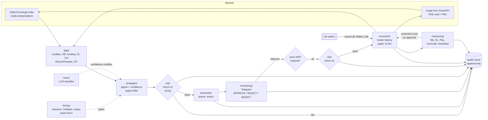

# Architecture

## Pipeline

## Module map

| Path | Role | Ticket |
|---|---|---|
| `config.py` + `config/*.yaml` + `.env` | Layered config, hard safety ceilings, two-key live switch | 1 |
| `logging_setup.py` | Console + JSON file logs, secret redaction | 1 |
| `audit.py` | Append-only, fsync'd JSONL audit trail, one file per IST date | 1 |
| `core/models.py` | Instrument, Signal, TradeProposal, OrderRequest, Fill, Position (Decimal prices) | 1 |
| `core/interfaces.py` | `MarketData`, `Broker`, `Strategy`, `RiskEngine`, `Notifier` ABCs | 1 |
| `markets/delta/client.py` | Delta REST: chunked candles (price/MARK/FUNDING/OI), ticker, orderbook, HMAC signer | 3 |
| `markets/angel/client.py` | Angel SmartAPI: TOTP auto-login, chunked historical candles, quotes | 3 |
| `markets/angel/instruments.py` | Angel instrument master: tokens, lot sizes, listed expiries | 3 |
| `execution/factory.py` | **Only** place a trading connection is built; paper unless live is validated (re-checked) | 1, 9 |
| `execution/exchange.py` | `DeltaExchange` (signed REST: leverage, IOC limit, position bracket, positions, fills) and `PaperExchange` (live-price fills, persisted) | 9 |
| `execution/engine.py` | Leverage-first, IOC entry with price cap, idempotent retries via client_order_id, exchange-side bracket or immediate close, reconcile (closed/mismatch/orphan/missing stop), flatten | 9 |
| `execution/orders.py` | Managed orders/positions + SQLite `data/execution.db` | 9 |
| `timing/` + `config/calendars/` | NSE sessions/holidays/expiry, crypto funding + low-liquidity windows, quiet hours; `TradingClock` gates: propose / execute / exit | 2 |
| `data/http.py` | Token-bucket rate limit, retry 429/5xx with backoff (never retries other 4xx) | 3 |
| `data/store.py` | DuckDB `data/market.duckdb`: candles (UTC, upsert) + ticker/orderbook snapshots | 3 |
| `data/quality.py`, `data/ingest.py` | Session-aware gap detection, OHLC sanity, incremental backfill | 3 |
| `data/verify.py` | Daily cross-check: funding times + expiry rules vs live exchange data | 3 |
| `strategies/indicators.py`, `features.py` | Causal indicators; shared feature frame; regime (trend_up/down, ranging, neutral, high_vol via ATR% percentile) | 4 |
| `strategies/base.py`, `crypto.py` | `Strategy` plug-in (`prepare` + `decide(f, i)`); ema_trend, donchian_breakout, rsi_pullback, vwap_intraday | 4 |
| `strategies/funding.py` | Funding cost in R + crowded-side confidence penalty | 4 |
| `strategies/engine.py` | Regime/direction/confidence/net-R:R gates -> `Signal` | 4 |
| `strategies/study.py` | Cost-aware event study to compare strategies (pre-backtest) | 4 |
| `risk/sizing.py` | Delta contract specs; size from stop distance (round down); liquidation estimate | 5 |
| `risk/engine.py` | `CryptoRiskEngine.assess(signal, state, stage, ctx)`: halts, daily loss, drawdown, loss cooldown, SL sanity, timing, event blackout, stale data, price drift, heat/gross/position caps, liq buffer. Reports ALL failures | 5 |
| `risk/state.py` | SQLite `data/risk_state.db`: equity marks, closed trades, halts (survive restarts) | 5 |
| `risk/manager.py` | Engine + state + audit; kill switch / resume | 5 |
| `risk/events.py` + `config/calendars/events.yaml` | FOMC / CPI blackout windows | 5 |
| `news/feeds.py`, `store.py` | 6 crypto RSS feeds (headline + summary only) -> `data/news.duckdb`, deduped; reads capped at decision time (no lookahead) | 6 |
| `news/classify.py` | Claude (structured JSON, effort low, server-side fallback) or keyword rules when no API key; labels: assets, sentiment, impact, horizon, category | 6 |
| `news/score.py` | Time-decayed, impact-weighted score per asset; asymmetric confidence modifier (-0.20..+0.05) | 6 |
| `news/pipeline.py` | update (fetch + classify NEW items only, per-run cost cap), digest | 6 |
| `backtest/execution.py` | 5m fill sim: approval delay, drift skip, slippage, maker/taker+GST, funding settlements, stop-first | 7 |
| `backtest/portfolio.py` | Portfolio sim calling the LIVE `CryptoRiskEngine` at proposal + execution (sizing, halts, caps, quiet hours) | 7 |
| `backtest/metrics.py` | MTM daily equity, CAGR/DD/Sharpe/Sortino/Calmar, per strategy/symbol/regime/exit, India tax (VDA vs business) | 7 |
| `backtest/walkforward.py` | Rolling train/test param selection; OOS-only stitched portfolio; IS-vs-OOS per fold | 7 |
| `proposals/model.py` | Proposal (all decision fields + history) and its text card | 8 |
| `proposals/store.py` | SQLite `data/proposals.db`; pending + expiry survive restarts | 8 |
| `proposals/engine.py` | create (risk check #1, dedupe, expiry, auto-approve gate) / modify (re-validated, size only <= risk cap) / approve (whitelist, expiry, drift -> cancel + fresh proposal, risk check #2, executor) / reject / expire sweeper | 8 |
| `execution/exits.py` | PositionManager: trailing (off by evidence), max-hold exit or extension request (needs approval, default close), target-ask mode, NSE square-off hook, daily review (alerts only) | 10 |
| `runtime.py` | The bot process: scheduler (tick 60s, signals at bar close+75s, news 30m, review, summary, heartbeat), safe mode | 11 |
| `monitoring/telegram.py`, `bot.py` | Bot API long-polling (no inbound port), inline APPROVE/REJECT/MODIFY + HOLD/CLOSE, whitelist, live-mode PIN w/ lockout, commands | 11 |
| `monitoring/health.py` | Heartbeat file, external `tradebot watchdog`, daily summary | 11 |
| `paper/ledger.py` | Forward-test ledger (`data/forward.db`): every passing signal incl. SHADOW (disabled) strategies, proposal link, uptime beats | 12 |
| `paper/evaluate.py` | Counterfactual outcomes with the backtest's 5m execution model (also values your rejections) | 12 |
| `paper/report.py` | Paper report: decisions, rejection value, slippage, paper-vs-backtest, forward record, go-live checklist | 12 |
| `monitoring/dashboard.py` | Read-only Streamlit dashboard (SQLite only; never locks market data) | 11 |

## Safety invariants

1. **Paper by default.** Live needs `mode: live` + the exact confirm phrase in YAML + `TRADEBOT_ALLOW_LIVE=true` in env + capital ≤ `live.max_capital_inr` + Telegram approval set up + auto-approve off. Checked at load **and** again in the broker factory.
2. **Config cannot exceed ceilings.** Risk/trade ≤ 2%, daily loss ≤ 5%, drawdown ≤ 20%, Delta leverage ≤ 5x. Unknown YAML keys are errors.
3. **No secret in YAML or logs.** Secrets only from env/.env, `SecretStr`, redacted from every log line.
4. **New positions only after approval; exits never wait for approval.**
5. **Every state change is an audit event.**

## Deployment (Ticket 13, paper part)

`Dockerfile` (python 3.12 slim, uv-frozen deps, non-root uid 10001, HEALTHCHECK = `tradebot health`) ·
`docker-compose.yml` (bot + watchdog; dashboard behind a profile on 127.0.0.1) · `deploy/setup_vps.sh`
(Ubuntu bootstrap: Docker, ufw SSH-only, fail2ban, unattended upgrades, chrony/UTC, swap, backup cron,
opt-in SSH hardening) · `deploy/DEPLOY.md` (runbook). No inbound ports: Telegram uses long polling.
